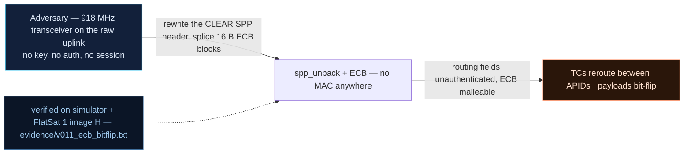

# V0-11 — AES-ECB malleability: clear SPP header + attacker-chosen ciphertext blocks

| Field | Value |
|---|---|
| ID | V0-11 |
| Severity | High — silent uplink tampering surface: routing metadata is in the clear and ciphertext blocks are malleable (C⊕Δ → P⊕Δ) with no integrity check anywhere (24\|21\|17) |
| Category | Crypto misuse (ECB without integrity) + missing authentication of routing fields |
| Interface | Radio uplink/downlink — SPP primary header (always clear) and the ECB secure-link payload |
| SPARTA | EX-0009.01 · Exploit Code Flaws: Flight Software; secondary EX-0012.02 Internal Routing Tables (APID re-routing), EX-0006 (v3.2, notional risk 24\|21\|17) |
| PoC | `poc/v011_ecb_bitflip.py` — evidence `evidence/v011_ecb_bitflip.txt` (`POC OK`) |

## Summary
Two ECB structural flaws compound: the SPP primary header (type, APID, flags, seq,
length) always travels in the clear, so routing metadata is visible and editable to
anyone with an SDR; and the ECB payload is malleable — flipping ciphertext bits flips
predictable plaintext bits, and blocks are independent so they can be reordered. The PoC
demonstrates that even an *opaque* attacker-supplied ciphertext block satisfies the
AES_CONFIG boolean sink.

## Attack diagram



## Root cause
Baseline defect kept from v1.0.3 (`worker.cpp` / `secure_link.cpp`): the secure link
encrypts only the SPP data field, never the 6-byte primary header, and uses raw ECB —
no MAC, no integrity tag. Downstream consumers trust what decryption yields; the
AES_CONFIG sink in particular only tests "recovered byte0 != 0" (`dec[0] != 0`), so any
16-byte block whose first decrypted byte is nonzero is a valid "crypto ON" command.

## Attack mechanism
1. **Clear header:** a wrapped GET_STATUS uplink begins on the wire with
   `10 0c 40 01 00 0f` — type=1 (TC), APID 0x0C, flags=1, seq=1, length=15 (+1 = 16).
   An SDR reads the APID directly; editing it re-routes the command (v2 finding V-12
   weaponizes this).
2. **Determinism:** ECB has no IV, so `C(01) == C(01)` — identical plaintext blocks
   (beacon fields, padded zeros) are identical ciphertext, enabling traffic analysis and
   building an oracle.
3. **Malleability/independence:** `C(P⊕Δ) = C(P)⊕Δ` per bit within a block, and changing
   block 0 leaves block 1's ciphertext untouched (the PoC's independence check passes).
4. **Boolean sink:** the attacker encrypts `00 01 42 5a×13` (plen=1, payload `0x42`) to
   the opaque block `78d61fd20dc167cb4ae...`; the craft decrypts it, sees byte0 = `0x42`
   ≠ 0, and switches crypto back ON.

## Exploitation walkthrough
1. Header and determinism observations:

```
encrypted TC wire header (in clear): 100c4001000f -> apid=10 visible to any SDR
determinism: C(b'01') == C(b'01') -> True
```

2. Drop crypto with the V0-10 cleartext toggle (`00` on APID 0x0A), then uplink the
   opaque 16-byte ciphertext (even length → the real decrypt path runs) with
   `spp_pack(0x0A, blk, 3)` on APID 0x0A:

```
opaque block C=78d61fd20dc1167cb4ae74f372a91f2d -> P=42 (byte0=0x42)
secure link state after opaque block: True
```

3. The PoC asserts determinism, the boolean-sink acceptance (`secure is True`), and
   block independence — three ECB properties an adversary can chain.

## Impact
Uplink integrity is nil: an on-path attacker (or the keyless one, post-V0-10) reroutes
commands by editing the clear APID, splices recorded blocks, or steers sink semantics
byte-by-byte — all undetectably, since nothing authenticates. During a pass this turns
"the operator is commanding" into "someone in the loop is commanding".

## Mitigations
- Add a per-frame MAC over header+payload (AES-CMAC already exists in the v2 core);
  cost: 1 extra AES pass per frame on unaccelerated RP2040 — milliseconds, negligible
  against pass timings.
- Encrypt or MAC the primary header's APID/type bits, or cross-check the APID against a
  field inside the secured payload (cheap consistency check).
- Replace the `byte0 != 0` sinks with strict length+content validation so opaque blocks
  can't drive state; honest trade-off: stricter parsers reject more legacy scripts.

## References
- PoC + evidence: `poc/v011_ecb_bitflip.py`, `evidence/v011_ecb_bitflip.txt`
- `docs/SPARTA_MAPPING.md` — baseline table row V0-11
- `../RAPPORT-FIRMWARE-VULNERABLE-FLATSAT.md` §2 baseline v1.0.3 catalog, row V0-11
  (`worker.cpp`/`secure_link.cpp`; internal catalogue row, no course chapter); wire
  formats: `simulator/flatsat_sim.py` (`spp_pack`, `sl_decode_key`)
