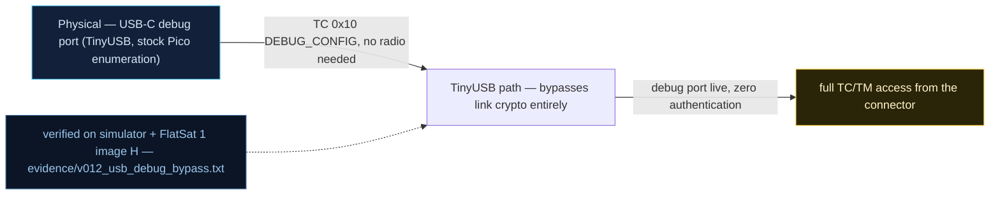

# V0-12 — USB debug backdoor bypasses all link crypto

| Field | Value |
|---|---|
| ID | V0-12 |
| Severity | Medium — total crypto defeat (cleartext TCs and TM leak on every transport), but the trigger requires one physical USB-C touch, which bounds realistic exposure to bench/launch/facility phases |
| Category | Debug backdoor / missing authentication on physical interface |
| Interface | USB-C debug port (TinyUSB, stock Pico enumeration) — TC APID 0x10 DEBUG_CONFIG; affects TM on all transports |
| SPARTA | IA-0011 · Auxiliary Device Compromise; secondary CM0037 Disable Physical Ports (countermeasure gap) (v3.2, no notional-risk triple published for these IDs) |
| PoC | `poc/v012_usb_debug_bypass.py` — evidence `evidence/v012_usb_debug_bypass.txt` (`POC OK`) |

## Summary
`DEBUG_CONFIG` (APID 0x10, USB-only) flips a global `bypass_secure_link`: the USB path
skips the AES engine entirely and **every telemetry frame leaves in cleartext on every
transport** — including the radio downlink. One moment of physical access to the USB-C
port converts the secure craft into a clear-text beacon; nothing re-locks it at boot.

## Attack diagram



## Root cause
Baseline defect kept from v1.0.3: the `bypass_secure_link` flag set by DEBUG_CONFIG is
consulted by both the TC decrypt gate and the TM wrap gate with no authentication of
the setter and no auto-expiry. The simulator mirror shows the scope precisely
(`flatsat_sim.py`): TC side `if self.secure and not (via == "usb" and self.usb_debug)`
(USB skips AES), TM side `if self.secure and not clear and not self.usb_debug` (no TM is
wrapped any more) — so the leak is craft-wide, not port-local.

## Attack mechanism
1. Physical attacker (facility visitor, integrator, launch-site operator) plugs into
   USB-C and sends APID 0x10 payload `01`.
2. The status TM 0x10 itself leaves **in clear** (`TM apid=0x10 clear len=4` =
   `[SC, usb_debug, secure, 0x01]`) — the backdoor announces itself.
3. Posture now: radio TCs still require AES (so the attacker can't command the radio
   path in clear), but USB cleartext TCs are accepted and — critically — the
   downlink streams unencrypted status (flags byte becomes `0x5f`, with the
   `FLAG_USB_DEBUG` bit 0x40 set) readable by any pass-side SDR.

## Exploitation walkthrough
1. Enable: `dev.tc(0x10, b"\x01", via="usb")` → evidence
   `debug status TM: usb_debug=1 secure_flag=1` (bypass ON while the nominal secure flag
   still reads 1 — the backdoor overrides it silently).
2. Confirm the radio path still demands crypto: cleartext GET_STATUS via radio returns
   `AES DECRYPT FAIL` (TM 0x09, clear len=17).
3. Confirm the USB bypass and the downlink leak:

```
--> TC apid=0x0C via=usb clear payload=-
<-- TM apid=0x0C clear len=27
clear TM on radio downlink: 01015f1f120a0a0800009403
```

4. `dev.tc(0x10, b"\x00", via="usb")` restores wrapping (`bypass off again:
   usb_debug=False`).

## Impact
For a craft that spends time physically exposed — integration, shipping, launch
campaign — an unauthenticated one-command debug switch means every subsequent pass can
be read without the key, and insiders can exfiltrate or inject via USB without leaving
crypto-shaped traces. It is also a pivot: cleartext status TM discloses mode/freq/
thruster state that feeds every radio-side attack.

## Mitigations
- SPARTA CM0037-style physical hygiene: disable or fuse the USB boot ROM/serial in the
  flight configuration, or require the GS session to honor DEBUG_CONFIG at all
  (CM0031 Authentication for the setter).
- Make the bypass non-persistent and *loud*: auto-clear on boot and reflect state in
  every beacon (the `0x40` flag bit exists — operators must alarm on it), so a
  facility-phase flip cannot silently ride into orbit.
- If a factory backdoor is kept, gate it on a challenge-response (production key
  injected per craft), cost: one more bench credential to manage.

## References
- PoC + evidence: `poc/v012_usb_debug_bypass.py`, `evidence/v012_usb_debug_bypass.txt`
- `docs/SPARTA_MAPPING.md` — baseline table row V0-12
- `../RAPPORT-FIRMWARE-VULNERABLE-FLATSAT.md` §2 baseline v1.0.3 catalog, row V0-12
  (`bypass_secure_link`; internal catalogue row, no course chapter); wire formats:
  `simulator/flatsat_sim.py` (`FLAG_USB_DEBUG = 0x40`)
