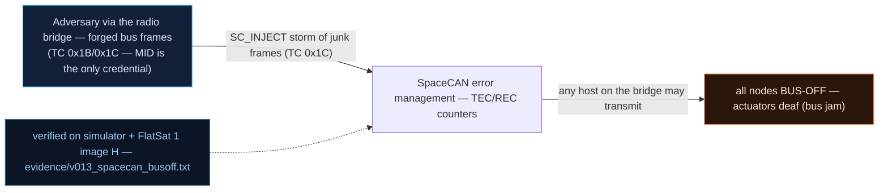

# V0-13 — SpaceCAN bridge: a junk-frame storm drives nodes BUS-OFF (bus jam)

| Field | Value |
|---|---|
| ID | V0-13 |
| Severity | High — 32 malformed frames silently kill the motor node; the node then ignores even valid commands until an explicit reset, so actuation is denied on demand (24\|21\|17) |
| Category | Missing bus authentication / Availability (error-management abuse) |
| Interface | SpaceCAN software bus over the radio bridge — TC APID 0x1C SC_INJECT (virtual bus: the RP2040 has no CAN controller and no PHY is populated — same as upstream v1.0.3) |
| SPARTA | LM-0002 · Exploit Lack of Bus Segregation; secondary EX-0013.02 Flooding: Erroneous Input (25\|24\|21) (v3.2, notional risk 24\|21\|17) |
| PoC | `poc/v013_spacecan_busoff.py` — evidence `evidence/v013_spacecan_busoff.txt` (`POC OK`) |

## Summary
The radio↔SpaceCAN bridge injects any frame the uplink carries, with no source
authentication. Malformed frames raise a node's error counter exactly like real CAN
PEC/format errors: 8 per junk frame, BUS-OFF at 256. An attacker uplinks 32 junk frames
and the motor node stops acting — even on perfectly valid later traffic.

## Attack diagram



## Root cause
Baseline defect kept from v1.0.3 (`spacecan.cpp`): no origin authentication on frames
(catalog issue #23), textbook CAN error management (TEC/REC to 256 → BUS-OFF) reachable
from the radio bridge, plus fragmented-reassembly bugs (2-byte global overflow at
`seq*6+len ≤ 258 > buffer[256]`, #26; `can_id` mixing across fragments, #27). The
simulator mirror `_sc_dispatch` raises `err += 8` for any frame with `dlc < 2` or a
bad function octet and sets `off = True` at 256.

## Attack mechanism
TC 0x1C payload: `[mode][can_id BE32][dlc][data...]`. Mode 0 = inject one frame.
- Junk frame `00 00000284 01 99`: `can_id 0x284` → function field `0x280` (actuation),
  node id `0x284 & 0x7F = 0x04` = MOTOR; `dlc=1` and data octet ≠ `0x01` → +8 errors.
  32 × 8 = 256 → BUS-OFF.
- Valid frame `00 00000284 02 01 64` (power 100) is **ignored** while the node is off
  (dispatch returns status 2).
- Node reset `03 00000284 00` (mode 3) also needs no auth — which is also the only
  recovery.
The bridge status TM 0x1C (cleartext, 8 bytes) exposes the bus-off bitmask at byte 3
and the max error counter at bytes 5–6.

## Exploitation walkthrough
1. Baseline: `SET_THRUSTER 0x04 payload=0000` (t0 power 0), GET_STATUS confirms `t0 == 0`.
2. Storm 32 junk frames (`payload=00000002840199`) on the radio, then one valid frame
   (`0000000284020164`) — evidence:

```
--> TC apid=0x1C via=radio AES  payload=00000002840199
...
busoff mask=0x01 err_count=256
thruster power after 'valid' frame while BUS-OFF: t0=0
```

3. The PoC asserts bit0 of the bus-off mask (MOTOR off) and `t0 == 0` after the *valid*
   frame — silent kill, no error TM from the node.
4. Recovery is an unauthenticated node-reset (`payload=030000028400`), after which the
   same valid frame acts again: `thruster power after recovery: t0=100`.

## Impact
The radio bridge turns any uplink holder into a bus-level adversary: propulsion
(actuation function `0x280`) can be pinned off for as long as they can keep uplinking,
denying attitude/Δv operations inside a single pass. Because BUS-OFF nodes stay silent,
the operator's symptom is "commands not taking effect" with no fault on the craft's own
APID surface — a debugging sinkhole.

## Mitigations
- Authenticate bridge-injected frames (a 4-byte token/MAC per frame — SpaceCAN's own
  secCAN concept); cost: bus bandwidth and software AES per frame, acceptable at these
  frame rates on RP2040.
- Rate-limit bridge injection and cap TEC growth per unit time, so a jam needs 32
  *slow* frames — trading attacker convenience for operator patience.
- Auto-recover BUS-OFF nodes with backoff + a distinct TM alarm (today only the manual
  mode-3 reset exists, itself unauthenticated); fix the adjacent reassembly overflow
  (#26) and `can_id` mixing (#27) with strict fragment session keys.

## References
- PoC + evidence: `poc/v013_spacecan_busoff.py`, `evidence/v013_spacecan_busoff.txt`
- `docs/SPARTA_MAPPING.md` — baseline table row V0-13
- `../RAPPORT-FIRMWARE-VULNERABLE-FLATSAT.md` §2 baseline v1.0.3 catalog, row V0-13
  (`spacecan.cpp`, #23/#26/#27; internal catalogue row, no course chapter); wire
  formats: `simulator/flatsat_sim.py` (`_sc`, `_sc_dispatch`; hardware honesty: the bus
  is a software simulation, as on the real board)
