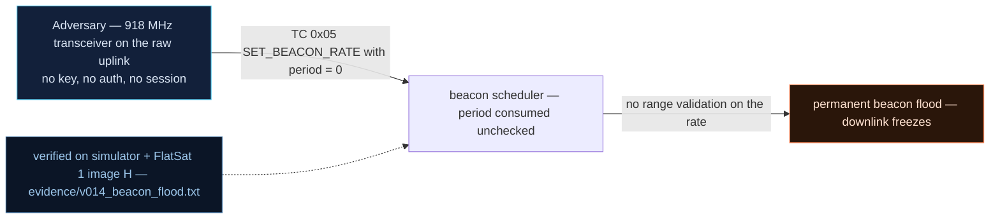

# V0-14 — SET_BEACON_RATE accepts 0 s → permanent beacon flood freezes the downlink

| Field | Value |
|---|---|
| ID | V0-14 |
| Severity | High — one byte saturates the entire downlink with junk beacons (50 per 5 s observed), drowning operator telemetry for as long as the attacker likes; fully reversible, no hardware harm (25\|24\|21) |
| Category | Missing input validation → resource exhaustion (Availability) |
| Interface | Radio uplink TC APID 0x05 SET_BEACON_RATE; downlink beacon on TM APID 0x01 |
| SPARTA | EX-0013 · Flooding; secondary DE-0002 Disrupt or Deceive Downlink, IMP Denial (v3.2, notional risk 25\|24\|21) |
| PoC | `poc/v014_beacon_flood.py` — evidence `evidence/v014_beacon_flood.txt` (`POC OK`) |

## Summary
`SET_BEACON_RATE` takes its interval in seconds and happily accepts `0`. The beacon
worker then emits a 64-byte beacon frame on *every* scheduler tick — 10 per second in
the lab model — so the legitimate telemetry channel is permanently occupied by beacons.
The command is unauthenticated, and the only cure is another (authenticated, if the
operator's luck holds) SET_BEACON_RATE.

## Attack diagram



## Root cause
Baseline defect kept from v1.0.3 (`worker.cpp:1523-1529`): the handler range-checks
`value <= 30` but not `value >= 1`, and `interval = 0` makes the "time since last
beacon > interval" test true on every tick. A related baseline quirk — preserved
byte-for-byte in the simulator — is that the beacon only starts ticking **after**
SET_BEACON_RATE has changed the value (`beacon_changed` flag), which is why the PoC sets
`01` first and `00` second.

## Attack mechanism
1. Uplink APID 0x05 payload `01` (1 s) — legitimate-looking, latches `beacon_changed`.
2. Uplink `00` — interval becomes 0 ms.
3. From the next tick the mission loop emits beacon TM APID 0x01 (64 B payload, AES
   wrapped → 64 B on the wire) every 100 ms tick: the ~18 s default beacon (`BEACON_
   DEFAULT_MS = 18000`) just became a 10 Hz stream, crowding out the 14 s housekeeping
   TM, 22 s nav TM, and any command ACK the operator waits for (the loop's TX queue is
   monopolized; in the real SX1262 downlink this is literal channel occupancy).

## Exploitation walkthrough
1. `dev.tc(0x05, b"\x01", via="usb")` then `dev.tc(0x05, b"\x00", via="usb")`.
2. Advance 5 s of mission time: `dev.advance(5000)` — the transcript fills with
   beacon frames:

```
--> advance(5000 ms)
<-- TM apid=0x01 AES len=64
<-- TM apid=0x01 AES len=64
beacons emitted in 5 s: 50
```

3. The PoC asserts `len(beacon) > 20`; the observed count is 50 beacons in 5 s (~640 B
   per 5 s of pure beacon traffic) — a >90 % duty cycle occupied by junk.

## Impact
An entire 5–15 min pass becomes unreadable: housekeeping, experiment telemetry, and
event timestamps back up or drop behind the beacon stream, while the attacker — who can
re-arm the flood with one more byte after each correction — holds the downlink open like
a hose. No state is corrupted, so it's "only" wasted science, but passes are the
mission's scarcest resource.

## Mitigations
- Validate the interval against a sane minimum (e.g. `1 <= v <= 30`, and reject
  "same as current" floods); one comparison, zero cost — this is the honest root fix.
- Prioritize queued operator TM over beacons and shed beacon load when the TX queue
  backs up (fair-queuing in the loop; small code, changes TM latency behavior — version
  it).
- Gate SET_BEACON_RATE behind the GS session (CM0031 Authentication); cost: routine
  ops changes get heavier, so scope the gate to *rate decreases* below a threshold.

## References
- PoC + evidence: `poc/v014_beacon_flood.py`, `evidence/v014_beacon_flood.txt`
- `docs/SPARTA_MAPPING.md` — baseline table row V0-14
- `../RAPPORT-FIRMWARE-VULNERABLE-FLATSAT.md` §2 baseline v1.0.3 catalog, row V0-14
  (`worker.cpp:1523-1529`; internal catalogue row, no course chapter); wire formats:
  `simulator/flatsat_sim.py` (`_beacon`, `beacon_changed` quirk)
