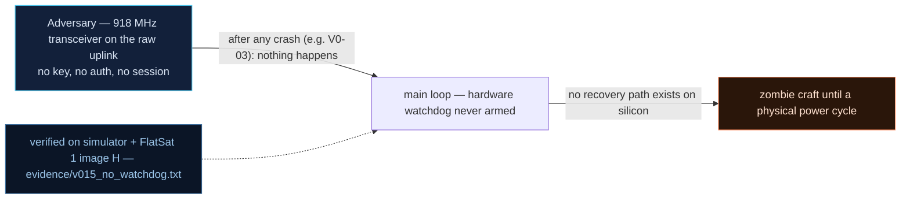

# V0-15 — No armed application watchdog → any crash survives until power cycle

| Field | Value |
|---|---|
| ID | V0-15 |
| Severity | High — this is the amplifier that converts every crash/hang (V0-03, SPI 9000, …) into total mission loss; on orbit nobody can unplug the board |
| Category | Missing resilience / Availability (watchdog never armed) |
| Interface | Craft-wide (C&DH recovery path); demonstrated over the radio APID surface |
| SPARTA | EX-0009.01 · Exploit Code Flaws: Flight Software; secondary DE-0003.11 Watchdog Timer (WDT) for Evasion — a missing WDT is itself an abuse surface (v3.2, notional risk 24\|21\|17) |
| PoC | `poc/v015_no_watchdog.py` — evidence `evidence/v015_no_watchdog.txt` (`POC OK`) |

## Summary
The baseline never arms the RP2040's hardware watchdog, so there is no path back from a
crash or hang: the craft that dies from the V0-03 one-byte broadcast stays silent
forever. The same absence makes hangs (busy-loop handlers) indistinguishable from
deaths, and secondary latency bugs — `ledBlink` blocking the loop for up to 3.2 s per
error — amplify any DoS in the meantime.

## Attack diagram



## Root cause
Baseline defect kept from v1.0.3 (`softwareReset`, `led.cpp`): nothing calls
`watchdog_enable`/`update` in the mission loop, and the reboot helpers
(`watchdog_reboot`, used by RESETC) exist but are only reachable *by command* — not by
liveness failure. The simulator models the consequence with a sticky `CRASHED` state:
`advance()` keeps time, but no worker ticks and `send()` returns nothing until
`powercycle()` re-boots the machine (`flatsat_sim.py`).

## Attack mechanism
1. Crash the craft with any known trigger — the PoC reuses V0-03:
   APID 0x06, payload `07` (length underflow → HardFault).
2. Poke it periodically: PING (APID 0x01) after each simulated minute.
3. Watch it stay dead: the crash survives 1, 2, 3, 4, 5 simulated minutes — there is no
   supervisor to bite, reboot, and re-enter safe mode; the mission simply stops.
4. The only observed recovery is the lab-only `POWER CYCLE (scratch + SRAM die, flash
   survives)` — on a CubeSat in orbit, that plug does not exist (only an eventual
   battery brownout might, unpredictably).

## Exploitation walkthrough
1. `dev.tc(0x06, b"\x07", via="radio")` → `sim.state == "CRASHED"`.
2. Five rounds of `advance(60000)` + PING, all silent — evidence transcript:

```
t+1 min: still silent (CRASHED)
t+3 min: still silent (CRASHED)
t+5 min: still silent (CRASHED)
no watchdog: mission loss confirmed after 5 simulated minutes
```

3. Only `dev.powercycle()` brings PING's ACK back (`<-- TM apid=0x01 AES len=5`), which
   the PoC asserts as "power cycle is the only recovery".

## Impact
This single missing line class turns the entire crash-class catalogue (V0-03 now; the
v2 SPI-9000 hang, memcpy RCE misdirection, etc., later) into mission-ending events.
One byte, one pass, game over — and because the failure mode is silence rather than a
safe-mode beacon (cf. REC-0007 monitor-for-safe-mode indicators), the operator may burn
several passes before concluding the craft is dead.

## Mitigations
- Arm the RP2040 hardware watchdog with a timeout above the worst legitimate loop
  (ledBlink's 3.2 s sets the floor — fix that first by making it non-blocking, or raise
  the WDT period accordingly); zero BOM cost, a few lines.
- Have the boot path record *why* it rebooted (WDT vs RESETC vs brownout) in the
  scratch registers and publish it in the boot banner TM, so crash-DoS becomes visible
  to the operator.
- Enter a degraded safe mode (crypto default policy, minimal beacon) after repeated
  WDT bites to avoid WDT-loop exhaustion of battery/pass budget — the v2 lab studies
  this interaction explicitly (watchdog cookie persistence, V-21).

## References
- PoC + evidence: `poc/v015_no_watchdog.py`, `evidence/v015_no_watchdog.txt`
- `docs/SPARTA_MAPPING.md` — baseline table row V0-15
- `../RAPPORT-FIRMWARE-VULNERABLE-FLATSAT.md` §2 baseline v1.0.3 catalog, row V0-15
  (`softwareReset`, `led.cpp`, `ledBlink` ≤ 3.2 s amplifier; internal catalogue row, no
  course chapter); model: `simulator/flatsat_sim.py` (`state = CRASHED`, `advance`,
  `powercycle`)
