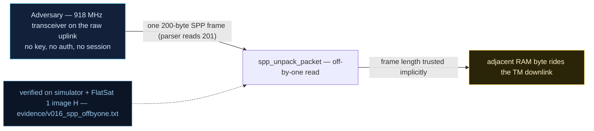

# V0-16 — `spp_unpack_packet` off-by-one: 201-byte copy declared out of a 200-byte frame

| Field | Value |
|---|---|
| ID | V0-16 |
| Severity | Medium — one adjacent-RAM byte leaks into every crafted TM echo (and the write side overflows `data[200]` by one); no crash, but a persistent, unauthenticated one-byte oracle |
| Category | Memory safety (off-by-one / out-of-bounds read) / Information exposure |
| Interface | SPP frame parser on both transports (radio uplink and USB); leak rides the TM downlink |
| SPARTA | EX-0009.01 · Exploit Code Flaws: Flight Software; secondary EXF-0003.02 Downlink Exfiltration (v3.2, notional risk 24\|21\|17) |
| PoC | `poc/v016_spp_offbyone.py` — evidence `evidence/v016_spp_offbyone.txt` (`POC OK`) |

## Summary
The SPP unpacker copies `length + 1` bytes out of the receive buffer but never checks
that the frame actually contains them. A frame declaring `length = 200` while carrying
200 data bytes makes the firmware memcpy **201** — reading one byte past the frame end
(and writing 201 into a `data[200]` buffer). The over-read byte is then echoed back on
the downlink: a free, unauthenticated peek at adjacent RAM.

## Attack diagram



## Root cause
Baseline defect kept from v1.0.3 (`spp.cpp:152-180`): `memcpy(data, buf + 6,
header.length + 1)` with no `buffer_len >= header.length + 7` validation, and a target
buffer sized `data[200]` while the maximum legal declaration (200) demands 201 bytes —
an off-by-one on both the read and the write edge. The simulator reproduces the parser
quirk byte-for-byte (`spp_unpack` pads to `ln + 1`; the pad byte `0xFF` models the
byte that lies beyond the frame in the VLA uplink buffer).

## Attack mechanism
1. Turn the secure link off with the V0-10 cleartext toggle (APID 0x0A, byte `00`) so
   the BROADCAST echo returns unencrypted and the leaked byte is readable.
2. Craft a raw frame: header `0006 4000 00c8` (APID 0x06, flags=1, seq=0, length field
   **200**) followed by exactly 200 `'A'` bytes — one byte fewer than the declared
   201.
3. The parser takes 201 bytes: 200 real + one phantom. BROADCAST_MSG strips its 2-byte
   frequency field, so the craft echoes a 199-byte message whose final byte is the
   over-read value (`0xFF` in the model).

## Exploitation walkthrough
1. Crypto off: `dev.tc(0x0A, b"\x00", via="usb", encrypt=False)`.
2. Parser-level confirmation — evidence:

```
declared data bytes = 201, bytes on wire = 200
parser returns 201 bytes, last byte = 0xFF (read past the frame)
```

3. Send the short frame over the radio (`dev._xfer(short_frame, "radio")`); the device
   answers with `TM apid=0x06 clear len=199`:

```
device echoed msg of 199 B, tail = 414141ff
```

4. The PoC asserts `unp["len"] == 201`, the phantom `0xFF`, and that the echoed payload
   ends in `b"\xff"` — the off-frame byte crossed the air.

## Impact
An attacker holding only the link's cleartext surface can repeatedly over-read past
uplink frames and harvest adjacent VLA/stack bytes — heap/stack layout trivia, stale
frame tails, and (in the v2 lineage, cf. V-04 padding leak) even GS challenges ride
out. Repeated variants shift which neighbor byte is sampled, making this a slow but
auth-free exfiltration channel; the 1-byte write overflow is a stability hazard riding
alongside.

## Mitigations
- Validate `received_bytes >= header.length + 7` before the copy and cap
  `length` at `sizeof(data) - 1` (two comparisons; the honest fix).
- Zero-fill or poison the parser's tail byte so accidental over-reads stop leaking
  stale RAM (cheap; may expose latent size bugs in tests loudly).
- Treat the 200/201 boundary with an explicit compile-time assert in the SPP structs;
  zero runtime cost. (Hardware honesty: on RP2040 an over-read usually stays inside
  SRAM, hence leak rather than fault — which is exactly why it exfiltrates.)

## References
- PoC + evidence: `poc/v016_spp_offbyone.py`, `evidence/v016_spp_offbyone.txt`
- `docs/SPARTA_MAPPING.md` — baseline table row V0-16
- `../RAPPORT-FIRMWARE-VULNERABLE-FLATSAT.md` §2 baseline v1.0.3 catalog, row V0-16
  (`spp.cpp:152-180`; internal catalogue row, no course chapter); wire formats:
  `simulator/flatsat_sim.py` (`spp_unpack` off-by-one mirror)
