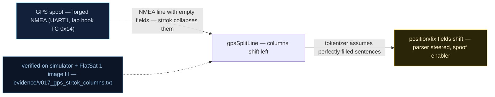

# V0-17 — GPS parser: `strtok` collapses empty NMEA fields → column shift

| Field | Value |
|---|---|
| ID | V0-17 |
| Severity | Medium — a forged sentence silently shifts every parsed column, writing wrong-but-believed values into the nav truth; exploitable fully only chained with V0-05's zero-integrity GPS path |
| Category | Input handling defect (parser) → sensor data spoofing enabler |
| Interface | GPS UART NMEA parser (`gpsSplitLine`); lab injection hook TC APID 0x14 / TM 0x0E |
| SPARTA | EX-0014.03 · Spoofing: Sensor Data; secondary EX-0009.01 (parser defect) (v3.2, no notional-risk triple published for these IDs) |
| PoC | `poc/v017_gps_strtok_columns.py` — evidence `evidence/v017_gps_strtok_columns.txt` (`POC OK`) |

## Summary
The NMEA splitter uses `strtok_r`-style splitting, which *skips* runs of delimiters.
NMEA semantics, however, treat consecutive commas as an **empty field** that still
occupies its column. An attacker who forges a sentence with emptied columns shifts every
later value one position left — and the receiver's checksumless trust (V0-05) accepts
the shifted garbage as a fresh fix.

## Attack diagram



## Root cause
Baseline defect kept from v1.0.3 (`gpsSplitLine` in `sensors.cpp`): the field splitter
drops empty tokens (`strsep`/`strtok` behavior of collapsing adjacent delimiters), so
column index ≠ NMEA field index whenever a field is blank. Correct NMEA parsing must
keep empty fields positional; here, `$GPRMC,A,,N,,W,...` silently promotes `'N'`
(the hemisphere character) into the latitude column.

## Attack mechanism
The PoC replays the firmware's column algorithm (`fields = [f for f in
sentence.split(",") if f != ""]`) on two sentences:
- well-formed: `123519,A,3606.1699,N,11508.3880,W,0.0,0.0,220426,,,A` → field[2] =
  `'3606.1699'` (correct latitude);
- forged with two empty columns: `123519,A,,N,,W,0.0,0.0,220426,,,A` → field[2] =
  `'N'` — every subsequent column (longitude, speed, date) slides left into the wrong
  variable.
Because the parser's output is consumed as nav truth with no checksum objection
available (V0-05), the device adopts whatever misalignment produces.

## Exploitation walkthrough
1. Column-alignment demonstration — evidence:

```
good sentence  -> lat field = '3606.1699'
forged sentence -> lat field = 'N'  (shifted!)
```

2. Feed the shift's end-state (zeroed fields) straight through the injection hook:
   `dev.tc(0x14, struct.pack("<iiiB", 0, 0, 0, 0), via="radio")` — payload
   `00000000000000000000000000`, 13 zero bytes.
3. Read nav back: `dev.tc(0x0E, b"", via="usb")` → `TM apid=0x0E AES len=30`; the PoC
   asserts `nav.le32(3) == 0` — evidence verdict:

```
zeroed/shifted position trusted -- no integrity layer to object
```

## Impact
Column shift is a *targeted-corruption* primitive against the nav model: with crafted
empties an attacker places any surviving token into any numeric column — latitude from
a hemisphere byte, date from a longitude — poisoning position, UTC and sats counters
without ever producing an invalid checksum (there is none). Downstream, GS range gating
and time-stamped telemetry all inherit the misaligned truth; in a 5–15 min pass window
the misbelief persists for the override's 300 s lifetime.

## Mitigations
- Split NMEA positionally (`strsep` keeping empty tokens, or ` sscanf` with `%[^,]`
  per column with explicit empty handling) and validate column count before use — the
  honest one-function fix.
- Validate field formats (lat `ddmm.mmmm`, hemisphere ∈ {N,S}) before accepting, so
  `'N'`-in-latitude is rejected rather than converted; cost: sentences from receivers
  that legitimately blank optional fields need the empty-column path, which is exactly
  what this fix restores.
- Combine with the V0-05 checksum + plausibility gates: each check alone catches this
  forgery at different layers (defense in depth for ~tens of lines total).

## References
- PoC + evidence: `poc/v017_gps_strtok_columns.py`, `evidence/v017_gps_strtok_columns.txt`
- `docs/SPARTA_MAPPING.md` — baseline table row V0-17
- `../RAPPORT-FIRMWARE-VULNERABLE-FLATSAT.md` §2 baseline v1.0.3 catalog, row V0-17
  (`gpsSplitLine`, `$GPRMC,A,,...` forged sentence; internal catalogue row, no course
  chapter); model: `simulator/flatsat_sim.py` (APID 0x14 override hook, TM 0x0E layout)
