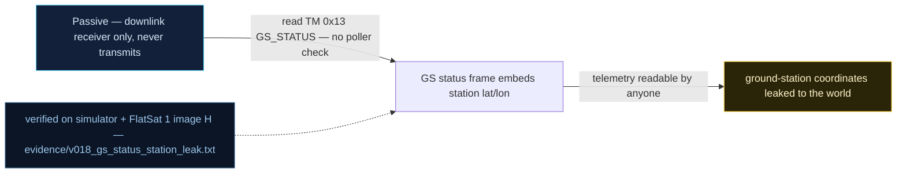

# V0-18 — GS_STATUS leaks ground-station coordinates to any poller

| Field | Value |
|---|---|
| ID | V0-18 |
| Severity | Low — pure passive information disclosure (station geolocation), but it hands an attacker precise uplink-targeting geometry for free, with no interaction required |
| Category | Information exposure via telemetry |
| Interface | Telemetry downlink — TM APID 0x13 GS_STATUS |
| SPARTA | REC-0003 · Gather Spacecraft Communications Information; secondary REC-0003.02 Commanding Details, EXF-0003.02 (v3.2, no notional-risk triple published for these IDs) |
| PoC | `poc/v018_gs_status_station_leak.py` — evidence `evidence/v018_gs_status_station_leak.txt` (`POC OK`) |

## Summary
The GS_STATUS telemetry frame publishes the ground station's own geography: latitude,
longitude, and the protected access radius. Anyone who merely *listens* to the
downlink — or issues the trivial poll — learns exactly where the ground station is
(36.1699, −115.1398, 35 km), a precision the operator would reasonably consider private
infrastructure data.

## Attack diagram



## Root cause
Baseline defect kept from v1.0.3 (`telemetrySPPTransmitGroundStatus`): the GS_STATUS
builder appends the station constants to every status report —
`<i gs_station_lat_e7><i gs_station_lon_e7><H radius_m>` at payload offsets 13, 17, 21 —
with no access differentiation. The full 23-byte TM layout:
`[SC][gs_status][gps_status][dist u16][session_s u16][challenge u32][challenge_s u16]
[station_lat i32][station_lon i32][radius u16]`. The simulator ships the same constants
(`GS_STATION = (361699000, -1151398000)`, `GS_RADIUS_M = 35000`). Note the frame also
carries the GS challenge field — the same leak that powers V0-06.

## Attack mechanism
1. Listen on the downlink (or poll APID 0x13 over any transport — the baseline pollers
   answer before authentication).
2. Decode bytes 13–16 and 17–20 as signed little-endian 1e-7 degrees, bytes 21–22 as
   the radius.
3. Result is exact station geolocation plus the geofence size — the very parameters the
   GS access scheme (V0-06) trusts: an attacker now knows which GPS fixes will pass the
   range gate when spoofing (V0-05/V-36), and where a directional uplink antenna or
   jammer should point.

## Exploitation walkthrough
1. Poll: `dev.tc(0x13, b"", via="usb")` → `TM apid=0x13 AES len=23`.
2. Decode with the PoC helpers (`le32s(13)`, `le32s(17)`, `le16(21)`) — evidence:

```
--> TC apid=0x13 via=usb AES  payload=-
<-- TM apid=0x13 AES len=23
leaked station: lat=36.1699 lon=-115.1398 radius=35000 m
```

3. The PoC asserts the exact triple `(36.1699, −115.1398, 35000)` — the leak is
   byte-precise, not incidental.

## Impact
Geolocation of the ground station is an operational-security loss: adversary-side
targeting for uplink interference or physical surveillance of the antenna site, plus
free calibration of the GPS-spoofing chain (the range gate's center and radius are now
known to microdegrees). Costs nothing to the attacker — it rides every GS_STATUS poll
inside any 5–15 min pass the craft schedules.

## Mitigations
- Remove station coordinates from the downlink TM (the spacecraft needs them, the
  listener does not) or quantize to a coarse region; zero runtime cost, only a TM
  version bump and operator doc churn.
- Gate *detail fields* behind an authenticated session (CM0031 Authentication):
  unauthenticated GS_STATUS could keep only booleans/status bytes, at the cost of
  debugging convenience for listening operators.
- Rotate/rehome the station constants if exposed (they are config, not identity);
  honest CubeSat note: on this mission class the exposure is reputation-grade, not
  safety-grade — prioritize accordingly.

## References
- PoC + evidence: `poc/v018_gs_status_station_leak.py`, `evidence/v018_gs_status_station_leak.txt`
- `docs/SPARTA_MAPPING.md` — baseline table row V0-18
- `../RAPPORT-FIRMWARE-VULNERABLE-FLATSAT.md` §2 baseline v1.0.3 catalog, row V0-18
  (`telemetrySPPTransmitGroundStatus`, station 36.1699/−115.1398/35 km; internal
  catalogue row, no course chapter); wire formats: `simulator/flatsat_sim.py`
  (`_tm_gs_status`)
